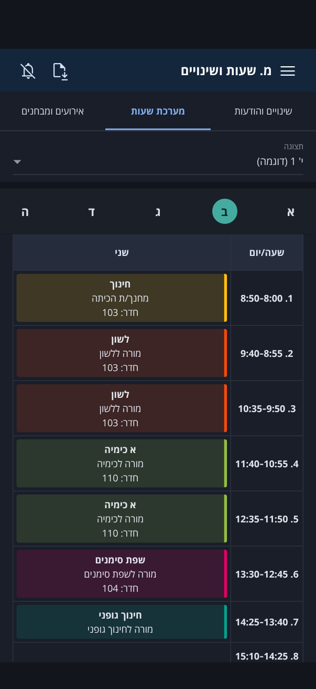
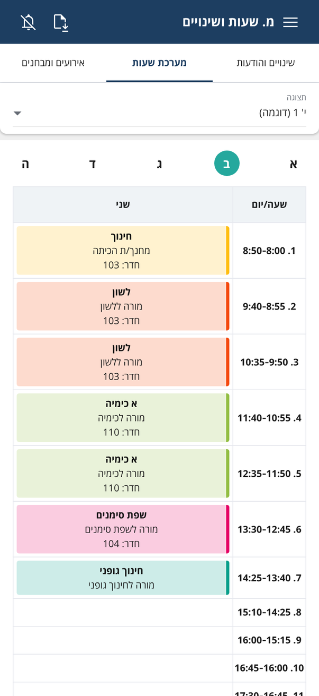
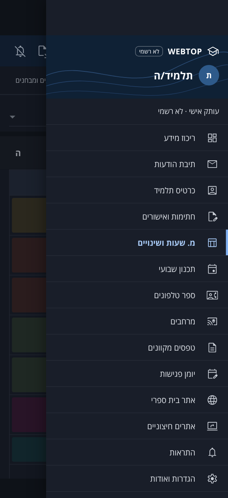
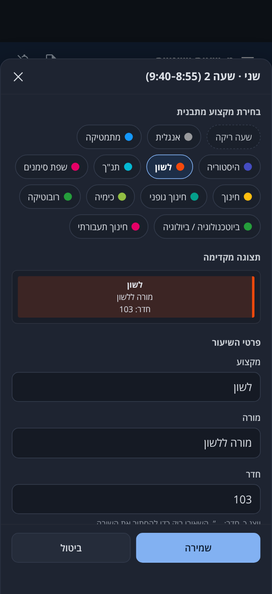

# מערכת שעות — WEBTOP‑inspired iPhone PWA (unofficial)

> **Unofficial personal project.** This app is *inspired by* the WEBTOP timetable screen. It is
> **not affiliated with, endorsed by, or connected to WEBTOP**, its vendor, the Ministry of
> Education or any school. It never asks for WEBTOP credentials and never calls WEBTOP endpoints.

An iPhone-first Progressive Web App that reproduces the look of the WEBTOP "מ. שעות ושינויים"
screen closely (dark theme, RTL, measured against frames of a reference screen recording).

It runs in one of two modes, chosen at build time:

- **Local mode** (no backend configured): the timetable, notices and exams are edited locally
  in a hidden edit mode and stored on the device.
- **Account mode** (Supabase configured): an administrator manages students, their profile
  pictures, subjects, timetables, notices and personal access codes in an admin panel at
  `#/admin`. Students sign in with their code, **one device per code at a time**, and stay
  signed in until they log out or an admin disconnects them. Setup:
  [docs/supabase-setup.md](docs/supabase-setup.md).

| Timetable | Light mode | Sidebar | Lesson editor (edit mode) |
|---|---|---|---|
|  |  |  |  |

*(Screenshots show the built-in **fictional example data**.)*

## Features

- **Timetable** for Sunday–Thursday with up to 13 periods (bell times taken from the reference).
  Includes a day selector, swipe navigation that never fights vertical scrolling, and a
  scroll-to-top button. Empty periods are real rows.
- **שינויים והודעות** and **אירועים ומבחנים** tabs backed by local data. The events tab has a
  month view, a kind filter, a group filter and `.ics` export.
- **ריכוז מידע** home screen: Hebrew date, greeting, editable shortcuts, today's lessons.
- **Sidebar** mirroring the reference menu. Entries with no local equivalent open clearly
  labelled placeholders.
- **Hidden local edit mode**. In it you can:
  - add, edit, duplicate, move, copy and delete lessons, or set a period empty;
  - fill subject, teacher, room and colour from a subject preset in one tap, with per-lesson
    overrides that never change the preset;
  - manage presets and choose whether to apply a changed preset to all its lessons (explicit
    confirmation required);
  - add, edit and delete notices, exams and events, and edit the display/class name;
  - export and import validated JSON, and reset any area after confirmation;
  - undo destructive edits from the confirmation toast.
- **PWA**: standalone display, safe-area aware, Apple touch icon and launch images, offline
  after the first load, and a versioned service worker with an update banner.
- **Light, Dark and System appearance** (Settings → מראה, and in the admin bar). Dark is the
  original design and the default; Light reproduces the original WEBTOP light screenshot (pastel
  lesson cards with the same subject edge colours); System follows the device and changes live.
  The choice is remembered on the device and applied before the first paint, so the app never
  flashes the wrong theme.

### Account mode (Supabase)

- **Admin panel** (`#/admin`, Supabase Auth email + password, admins listed in `public.admins`):
  - **Users**: searchable list with connection and code status; create, edit, disable/enable
    and delete students (display name, class, optional school and description).
  - **Profile pictures**: JPG/PNG/WebP upload, drag-to-position crop with zoom, round and square
    previews, exported as a 512×512 WebP (JPEG fallback) to a private Storage bucket; shown in
    the student's side menu and settings (the app bar keeps the original WEBTOP layout).
  - **Access codes**: strong generated codes or custom ones with strength warnings (weak codes
    need an explicit opt-in); shown **once**, stored only as an HMAC; replace or revoke; last
    use and current connection shown.
  - **Sessions dashboard**: who is signed in, on which device, since when, last activity,
    expiry ("none — until disconnected"), with **Force Disconnect**, revoke code and disable
    account.
  - **Subjects per user**: every student has an **independent** subject list on their user
    page (Users → user → מקצועות): add, edit, duplicate, hide or remove subjects with name,
    teacher, room and colour; add several at once from the library or copy all/selected from
    another student. Copies are independent, so changing one student's subjects never affects
    anyone else. Removing a subject that is in use asks first: move its lessons to another
    subject, empty those periods, or only hide it.
  - **Subject library** (מאגר): the admin's subjects for templates and as a copy source; no
    student ever sees it.
  - **Templates**: visual week editor (tap a cell, move/copy, mouse drag-and-drop with Alt/Ctrl
    to copy), bell-time editor (1–13 periods), duplicate, and assign to one or many students
    with an explicit choice before overwriting customised timetables. Assigning copies the
    template's library subjects into each student's own list (reusing earlier copies).
  - **Per-student timetable** editor (with that student's own subjects only), plus notices
    and events/exams for everyone or for one student.
- **Students**: a single access-code field (with a warning never to type a WEBTOP password).
  The server allows **one live session per code**: a second device is refused, never the
  first. Sessions persist indefinitely with rotating refresh tokens; nothing expires on
  inactivity. The 7-tap edit mode lets a signed-in student arrange **their own** timetable from
  **their own** subject list (picking a subject fills in its teacher, room and colour; students
  cannot change the subjects themselves); changes are saved to their account and never grant
  admin access.

## Requirements

- Node.js 20.19+ (CI uses Node 22)
- iPhone / iPad: iOS 15.4 or later (native `<dialog>`, `dvh` units)

## Getting started

```bash
npm ci
npm run dev          # http://localhost:5173/WEBTOP/
npm run check        # typecheck + lint + unit tests + production build
npm run test:e2e     # Playwright (builds must exist: run `npm run build` first)
npm run preview      # serve dist/ at http://localhost:4173/WEBTOP/
```

The service worker is registered only in production builds (`build` + `preview`), never by the
dev server.

| Script | Purpose |
|---|---|
| `typecheck` | `tsc -b` in strict mode across app, service worker, tooling and e2e projects |
| `lint` | ESLint (typescript-eslint strict and React Hooks / React Compiler rules) |
| `test` | Vitest unit tests for domain rules, storage, validation and backups |
| `test:e2e` | Playwright on an iPhone-sized Chromium against the production build under `/WEBTOP/` |
| `stack` | Starts the local Supabase-equivalent stack (see [docs/supabase-setup.md](docs/supabase-setup.md)) |
| `test:backend` | Vitest against the running stack: RLS, isolation, single session, codes, admin RPCs |
| `test:e2e:account` | Playwright in account mode against the running stack (admin panel + students) |
| `icons` | Regenerates the app icons and iOS launch images (`scripts/generate-icons.mjs`) |

## Using it on an iPhone

1. Open **https://omriweb10.github.io/WEBTOP/** in Safari (once GitHub Pages is enabled; see below).
2. Tap **Share → Add to Home Screen**, then launch it from the Home Screen icon.
3. Load your own data in the installed app (step 4 explains why): enter edit mode, then
   **כלים → ייבוא מקובץ JSON…**, and pick your private backup file.
4. A Home Screen web app on iOS has **separate storage from Safari**. Data imported in a Safari
   tab does not appear in the installed app, and the reverse.

### Hidden edit mode

Tap the title **"מ. שעות ושינויים" seven times quickly**. Edit mode opens at once, with no code
or confirmation. A yellow strip shows that you are editing the **personal local copy** (in
account mode: your own timetable, saved to your account). Use **יציאה** to leave; a cold start
always opens in viewing mode.

> The gesture is a UI shortcut that keeps edit controls out of the way. It is **not** a security
> mechanism and grants no access to the official WEBTOP system or to the admin panel. In account
> mode it works only with a signed-in session the server has confirmed (and a connection), and
> the server decides what may change: only the signed-in student's own timetable, using only
> the subjects in their own list. In local mode there are no accounts and nothing leaves the
> device.

To edit a lesson, tap it (or an empty "+ הוספת שיעור" cell) while edit mode is on. In local mode
the **כלים** screen (`#/tools`) holds presets, the profile/class name, backup and import, and
resets. In account mode those belong to the administrator.

### Where your data lives (read this)

In account mode the server holds the data and the device keeps a cached copy for offline use;
see [docs/supabase-setup.md](docs/supabase-setup.md) for how sessions persist. In local mode:

- Everything is stored in the browser's **localStorage** for this origin, with a versioned and
  validated envelope per data area.
- **Clearing Safari website data, deleting the Home Screen app, or moving to a different URL
  (origin) can erase your edits.** Export a JSON backup now and then. The app also asks the
  browser for persistent storage.
- If stored data is ever unreadable, it is **kept** under a `*.corrupt.<timestamp>` key, the app
  falls back to defaults, and you see a message. Data is never discarded silently.

## Private data (real timetable)

This repository is **public**, so it contains **no real names, rooms, school name or personal
timetable**. The built-in data is a fictional example: teachers are "מורה ל…", rooms are
101–112, and the class name is "(דוגמה)". Subject names, bell times and colours are generic and
committed.

Keep your real data in a backup JSON that is **never committed**:

- `private/` and `*.private.json` are gitignored.
- `npm test` validates any `private/*.private.json` it finds, so a broken file is caught before
  you import it.

## Deployment (GitHub Pages)

`.github/workflows/deploy.yml` runs **typecheck → lint → unit tests → build → Playwright e2e**
on every pull request and on pushes to `main`. A second job starts the local Supabase-equivalent
stack and runs the backend suite and the account-mode e2e tests. On `main` it then deploys to
GitHub Pages, built with the repository variables `VITE_SUPABASE_URL` and
`VITE_SUPABASE_ANON_KEY` when they are set (account mode), or without them (local mode).

One-time setup (repository owner):

1. **Settings → Pages → Build and deployment → Source: _GitHub Actions_.**
2. Merge the PR into `main`; or, once the workflow is on `main`, run it manually from the
   **Actions** tab (*Run workflow* on `main`).
3. The site is published at `https://omriweb10.github.io/WEBTOP/`.

The Vite `base`, manifest `scope`/`start_url` and service-worker scope all resolve to
`/WEBTOP/`. Builds use `BASE_PATH` (the workflow sets it to `/<repository name>/`; locally it
defaults to `/WEBTOP/`). For a custom domain at the root, build with `BASE_PATH=/`. Routing uses
the URL hash (`#/schedule/events`), so deep links work on Pages without server rewrites.

## Offline & updates

- At build time a small Vite plugin (`build/serviceWorkerPlugin.ts`) compiles
  `src/sw/service-worker.ts`. It injects the list of emitted files and a **content hash**
  version, which becomes the cache name.
- **Navigations** are network-first with a 3 s timeout, falling back to the cached shell
  offline. **Assets** are cache-first: they are hashed and immutable.
- Activation **deletes caches of older versions**.
- `sw.js` is fetched with `updateViaCache: 'none'`. Updates are checked at launch, when the app
  returns to the foreground, and every 30 minutes.
- A new version found while you use the app shows **"גרסה חדשה… רענון"**. If a new version is
  already waiting when the app starts, it is activated immediately with a single reload, so
  nobody stays on an old version.
- iOS launch images are excluded from the precache; the OS fetches them at install time.

## Architecture

React 19 + TypeScript (strict) + Vite 7, with zustand for state and zod for validation. No router
library and no icon package at runtime. The backend (account mode) is Supabase; its client, the
login gate and the admin panel are code-split and never downloaded by a local-mode build.

```
src/
├── app/                 App shell, hash router, route→screen mapping, sidebar menu config
│   └── screens/         Composition screens (ScheduleHubScreen: the three tabs)
├── components/
│   ├── layout/          Header, NavigationTabs, Sidebar (+header), ScreenFrame
│   └── ui/              Button, IconButton, Icon (+generated Material Symbols paths), Modal,
│                        ConfirmHost/confirm(), fields, ColorPicker, SectionCard, ItemRow, Toasts…
├── features/
│   ├── timetable/       components/ (TimetableTab, TimetableTable, LessonCard, EmptyPeriod,
│   │                    DaySelector, LessonEditor, MoveCopyPanel, export sheet, print layout),
│   │                    hooks/ (swipe, scroll), domain/ (pure: ops, days, periods, drafts, ICS),
│   │                    timetableActions (undoable use-cases), view store
│   ├── presets/         Preset picker/manager/form + pure preset↔lesson rules + actions
│   ├── admin/           7-tap detector, edit-mode store and capabilities (who may enter),
│   │                    local tools screen, import/export & reset use-cases
│   ├── account/         Account mode: login screen and gate, session runtime (validation,
│   │                    heartbeat, logout), timetable sync, bundle schema/mapping, account UI
│   ├── adminPanel/      #/admin: api/ (typed Supabase calls), domain/ (pure rules: filters,
│   │                    crop geometry, schedule model, validation, errors), state/ (cached
│   │                    lists), components/ (users, sessions, presets, templates, schedule
│   │                    grid, content, shared)
│   ├── notices/ events/ Tabs, editors, pure sort/filter/group rules, actions
│   ├── home/ settings/ placeholders/
├── schemas/             zod schemas: the single source of truth for persisted & imported data
├── config/              Backend configuration (build-time Supabase URL/key → account mode)
├── services/
│   ├── supabase/        Student/admin clients (separate auth storage) and error classification
│   ├── storage/         KeyValueStore abstraction, versioned envelopes, migrations, quarantine
│   ├── backup/          Backup file creation/parsing (all-or-nothing validation)
│   ├── calendar/        RFC 5545 writer
│   ├── files/           Share-sheet / download / file reading
│   ├── pwa/             Service-worker registration & update manager
│   └── session/         Local launch tracking
├── store/               Persisted zustand stores (one per data slice) + UI store
├── sw/                  Service worker (separate tsconfig with WebWorker lib)
├── theme/               Appearance: config, pure resolution, persisted preference, DOM application
│                        (data-theme + chrome metas), system subscription, card tints, ThemeSelector
├── styles/              tokens.css (sizes/typography/motion), themes/dark.css + themes/light.css
│                        (every colour as a semantic token), fonts, globals
├── data/                Default periods, presets, fictional example timetable
└── utils/               Dates, Hebrew calendar numerals, time, colour mixing, ids
tests/unit/              Vitest (app domain rules)
tests/functions/         Vitest (Edge Function handlers and access-code rules, with fakes)
tests/backend/           Vitest against the local stack (database, RLS, functions)
tests/e2e/               Playwright, local mode
tests/e2e-account/       Playwright, account mode against the local stack
supabase/                migrations/, functions/ (student-login, admin-access-code, _shared), config.toml
scripts/local-stack/     Local Supabase-equivalent stack used by tests and CI
docs/visual-spec.md      UI inventory, measurements, colours, deviations
docs/supabase-setup.md   Backend setup, session model, local stack
```

Design rules followed:

- Business rules are **pure functions** (`features/*/domain`) with unit tests. Components call
  use-case modules (`*Actions.ts`) and never contain timetable rules.
- Persistence sits behind the storage service. Every value is validated **on load, on save and
  on import**.
- Display tokens are centralised: sizes and typography in `src/styles/tokens.css`, colours as
  semantic tokens in `src/styles/themes/dark.css` and `light.css`. Components never contain
  literal colours (a unit test enforces this), so a theme is just a set of token values.

### Themes and iOS

- `index.html` runs a tiny inline script before any CSS or app code: it reads the saved
  preference, sets `<html data-theme>`, and updates `theme-color`, `color-scheme` and the iOS
  status-bar style. `tests/unit/theme.test.ts` runs that script against the app's own resolver.
- Dark keeps the translucent iOS status bar over the app's dark band (unchanged). Light asks iOS
  for its light status bar with dark text; iOS reads that setting when the Home Screen app
  launches, so after switching theme inside a running app the band under the status bar stays
  navy (legible white status text) until the next launch.
- The manifest colours and launch images stay dark: they are fixed at install time.

### Backup file format

```json
{
  "format": "webtop-pwa-backup",
  "formatVersion": 1,
  "exportedAt": "2026-10-19T08:00:00.000Z",
  "appVersion": "1.0.0",
  "data": {
    "timetable": { "periods": [{ "number": 1, "start": "8:00", "end": "8:50" }],
                   "days": { "sun": [null], "mon": [], "tue": [], "wed": [], "thu": [] } },
    "presets": [{ "id": "preset_math", "name": "מתמטיקה", "subject": "…", "teacher": "", "room": "", "color": "#1498fd" }],
    "profile": { "studentName": "", "subtitle": "", "className": "י' 1" },
    "notices": [], "events": [], "settings": { "…": "…" }
  }
}
```

Every part of `data` is optional, so presets can be exported and restored on their own. Each
day must have exactly one cell per period: a lesson object or `null` for an empty period.

## Testing status

- Unit tests (Vitest): timetable operations, preset propagation and overrides, storage
  versioning/migration/quarantine, backup validation, ICS, Hebrew dates, the tap gesture.
- E2E (Playwright, Chromium with iPhone viewport and touch): day/tab/sidebar navigation, real
  touch swipes vs vertical scroll, the FAB, edit-mode unlock and exit, preset fill, overrides,
  empty↔lesson, duplicate/move/delete/undo, preset propagation with confirmation, resets,
  JSON export/import (valid and invalid), notices/exams persistence, change alerts, corrupted
  storage handling, manifest/icons, offline reload, cleanup of old caches, and a clean console.
- Visual: screenshots at the reference geometry were compared frame-by-frame with the
  recording. See `docs/visual-spec.md`.

- Account mode:
  - **Backend** (Vitest + the real Postgres/Auth/PostgREST/Deno stack): 12 concurrent logins
    with one code → exactly one success; device B rejected until A logs out; no release on
    inactivity; refresh-token rotation; force disconnect, revoked/replaced codes and disabled
    accounts end access and revoke refresh tokens; rate limiting per IP; hashes only; student
    isolation; blocked direct writes; storage policies; admin-only code issuance and RPCs;
    templates vs customised timetables; per-user subjects (two students with same-named
    subjects stay independent, edits never cross over, students read only their own, copying
    creates independent rows, removing a subject in use needs an explicit choice); and the
    migration from shared presets keeps every existing timetable intact.
  - **E2E** (Playwright against the stack): admin sign-in and non-admin rejection; create a
    student, upload and crop a picture, weak custom code opt-in, show-once codes and
    replacement; per-user subjects (add, copy from the library and from another user, edit,
    duplicate, warn-before-remove with replacement, hide) and per-student timetable editing;
    template building and the customised-timetable confirmation; library CRUD/archive; sessions
    dashboard force
    disconnect; student sign-in, persistence across reloads and token expiry, second device
    rejected, simultaneous sign-ins (exactly one wins), sign-out on disconnect/revoke/disable,
    restricted edit mode (opened by the gesture alone, showing only the student's own subjects)
    saved to the server and still there after logging out and back in, and the gesture never
    opening the admin panel.

Not covered automatically: real iOS Safari/WebKit (CI uses Chromium), "Add to Home Screen"
itself, iOS launch images, and a hosted Supabase project (the tests use the local stack).
Check those on a device and after setting up the project.

## Third-party notices

- **Open Sans**: SIL Open Font License 1.1 (via `@fontsource/open-sans`).
- **Material Symbols** path data (`src/components/ui/icons/iconPaths.ts`): © Google, Apache
  License 2.0.
- App icon, launch images and the home-screen illustration are original to this project. No
  WEBTOP assets are used or hot-linked.
